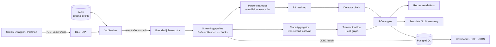

# LogSense – AI Log Analysis & Root Cause Analysis Platform

[](https://github.com/Pasupuleti-Meghana/ai-log-rca-platform/actions/workflows/ci.yml)


[](LICENSE)

LogSense is a Spring Boot 3 / Java 21 backend that ingests logs from distributed microservices and:

- Reconstructs distributed transactions
- Detects failures and incidents
- Identifies **which service failed first and why**
- Generates Root Cause Analysis (RCA) reports through APIs, PDF reports, JSON exports, and dashboards

## Table of contents

- [Problem statement](#problem-statement)
- [Sample RCA output](#sample-rca-output)
- [Features](#features)
- [Architecture](#architecture)
- [Tech stack](#tech-stack)
- [Getting started](#getting-started)
- [Sample walkthrough](#sample-walkthrough)
- [Performance demo](#performance-demo)
- [Tests](#tests)
- [Project structure](#project-structure)
- [Future enhancements](#future-enhancements)
- [Limitations](#limitations)
- [License](#license)

---

## Problem statement

In a microservice architecture, a single fault (for example, an exhausted database connection pool in
`inventory-service`) may surface as downstream timeouts in `order-service` and `504 Gateway Timeout` errors at the
`api-gateway`.

During production incidents, engineers often need to manually inspect logs across different services, correlate
trace IDs, reconstruct call flows, and determine the actual source of failure.

Most monitoring systems alert on the **symptom** rather than the **cause**.

LogSense automates log correlation, distributed transaction reconstruction, incident analysis, and root cause
identification while providing an explainable confidence score.

## Sample RCA output

```json
{
  "rootCauseService": "inventory-service",
  "rootCauseCategory": "DATABASE",
  "confidence": 0.95,
  "causalChain": [
    "api-gateway",
    "order-service",
    "inventory-service"
  ],
  "recommendation": "Check for connection leaks and review HikariCP pool sizing."
}
```

## Features

| Area | Description |
|---|---|
| Ingestion | Upload logs up to 500 MB through asynchronous jobs with progress tracking |
| Parsing | Supports JSON, Spring Boot, Log4j, Nginx, Apache, and mixed-format logs |
| Extraction | Extracts timestamps, trace IDs, correlation IDs, spans, exceptions, statuses, durations |
| Transaction tracking | Reconstructs distributed call chains and service graphs |
| Failure detection | Detects database, timeout, retry exhaustion, communication, and generic failures |
| RCA engine | Determines probable root cause, causal chain, and confidence score |
| AI summary | Generates deterministic RCA summaries with optional LLM enhancement |
| Reporting | Dashboard, JSON export, PDF generation |
| Operations | OpenAPI, Prometheus metrics, Flyway migrations, Actuator endpoints, Docker deployment |

## Architecture



Details are available in:

| Document | Contents |
|---|---|
| [ARCHITECTURE.md](docs/ARCHITECTURE.md) | Sequence diagrams, RCA analysis logic, design trade-offs, scaling considerations |
| [ER-DIAGRAM.md](docs/ER-DIAGRAM.md) | Data model |
| [API.md](docs/API.md) | REST endpoint reference |
| [DEPLOYMENT.md](docs/DEPLOYMENT.md) | Docker and production deployment |
| [FILE-GUIDE.md](docs/FILE-GUIDE.md) | What every file does |

## Tech stack

| Area | Technologies |
|---|---|
| Core | Java 21, Spring Boot 3, Spring Web, Bean Validation |
| Data | Spring Data JPA, Hibernate 6, PostgreSQL 16, Flyway |
| API & monitoring | OpenAPI, Actuator, Micrometer Prometheus |
| Reports & AI | OpenPDF, Jackson, OpenAI-compatible APIs |
| Optional | Spring Kafka |
| Testing | JUnit 5, Mockito, MockMvc, Awaitility, H2, Testcontainers |
| Deployment | Docker, Docker Compose, GitHub Actions |

## Getting started

### Prerequisites

- JDK 21 and Maven 3.9+
- Docker (for Option A), or a local PostgreSQL 16 (for Option B)

### Clone

```bash
git clone https://github.com/Pasupuleti-Meghana/ai-log-rca-platform.git
cd ai-log-rca-platform
```

### Option A: Docker Compose

```bash
docker compose up --build -d
```

### Option B: Local PostgreSQL

Database, user and password default to `logsense`.

```bash
mvn clean verify
java -jar target/ai-log-rca-platform-1.0.0.jar
```

### Available endpoints

- Swagger UI: **http://localhost:8080/swagger-ui.html**
- OpenAPI: http://localhost:8080/v3/api-docs
- Metrics: http://localhost:8080/actuator/prometheus
- Postman: import `postman/LogSense.postman_collection.json`

## Sample walkthrough

Sample datasets are available under `samples/`.

| File | Scenario | Expected root cause |
|---|---|---|
| `cascade-db-pool-exhaustion.log` | Hikari connection pool exhaustion | `inventory-service` |
| `retry-exhaustion.log` | Retry exhaustion after dependency failures | `payment-service` |
| `json-format.log` | Database deadlock | `order-service` |
| `mixed-format.log` | Mixed log formats | Multiple incidents |

**Upload**

```bash
curl -F "file=@samples/cascade-db-pool-exhaustion.log" \
  http://localhost:8080/api/v1/jobs
```

**Check job status**

```bash
curl http://localhost:8080/api/v1/jobs/{jobId}
```

**View RCA**

```bash
curl http://localhost:8080/api/v1/jobs/{jobId}/incidents
```

**Transaction flow**

```bash
curl http://localhost:8080/api/v1/jobs/{jobId}/service-graph
```

**Generate reports**

```bash
curl -o rca.pdf \
  http://localhost:8080/api/v1/incidents/{incidentId}/report/pdf
```

## Performance demo

Generate a large synthetic log file and upload it.

**Windows**

```powershell
java src\test\java\com\logsense\tools\LogGenerator.java target\large.log 1000000
curl.exe -F "file=@target\large.log" http://localhost:8080/api/v1/jobs
```

**Linux / macOS**

```bash
java src/test/java/com/logsense/tools/LogGenerator.java target/large.log 1000000
curl -F "file=@target/large.log" \
  http://localhost:8080/api/v1/jobs
```

## Tests

```bash
mvn clean verify
mvn test -Dtest=RcaEngineTest
mvn test -Dtest=LogSenseIntegrationTest
```

The project contains 100+ automated tests covering:

- Log parsing
- Stack-trace assembly
- Failure detection
- Root cause analysis
- Recommendation generation
- PII masking
- PDF reporting
- REST APIs
- Dashboard functionality
- End-to-end workflows
- PostgreSQL integration tests using Testcontainers

## Project structure

```
src/main/java/com/logsense
├── ai/          template and OpenAI-compatible LLM summarizers
├── api/         versioned REST controllers (/api/v1)
├── config/      async executors, OpenAPI, AI client, properties
├── domain/      JPA entities and enums
├── dto/         request/response records
├── exception/   RFC 7807 error handling
├── kafka/       optional Kafka ingestion (kafka profile)
├── mapper/      entity → DTO mapping
├── processing/  streaming pipeline, parsers, PII masking, detectors, transaction flow
├── rca/         incident clustering, RCA engine, recommendations
├── reporting/   dashboard, PDF and JSON reports
├── repository/  Spring Data repositories + Specifications
└── service/     job orchestration, events, metrics, report/incident services
samples/  realistic multi-service log files
tools/    scripts to generate large log files
docs/     architecture, ER diagram, API, deployment, file guide
```

## Future enhancements

- Kafka-first ingestion with Kafka Streams or Flink
- OpenTelemetry OTLP ingestion
- ClickHouse or OpenSearch support
- Durable job queues and recovery
- RCA score learning from historical incidents
- Anomaly detection on error rates
- OAuth2 authentication and multi-tenancy
- React dashboard with interactive graphs
- Slack and PagerDuty notifications

## Limitations

- In-flight jobs are lost if the JVM terminates during processing
- Trace aggregation maintains configurable in-memory state
- Message-based service-call inference relies on heuristics
- Kafka integration is currently not covered by automated tests

## License

[MIT](LICENSE)
