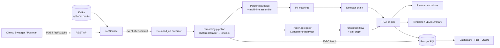

# LogSense – AI Log Analysis & Root Cause Analysis Platform

[](https://github.com/Pasupuleti-Meghana/ai-log-rca-platform/actions/workflows/ci.yml)


LogSense is a Spring Boot 3 / Java 21 backend. It ingests logs from many microservices and:
- reconstructs distributed transactions,
- detects failures,
- works out **which service failed first and why**,
- produces RCA reports (API, PDF, JSON, dashboard).

## Table of contents

- [Problem statement](#problem-statement)
- [Features](#features)
- [Architecture](#architecture)
- [Tech stack](#tech-stack)
- [Getting started](#getting-started)
- [Sample walkthrough](#sample-walkthrough)
- [Tests](#tests)
- [Project structure](#project-structure)
- [Documentation](#documentation)
- [Resume bullet points](#resume-bullet-points)
- [Future enhancements](#future-enhancements)
- [Limitations](#limitations)

---

## Problem statement

In a microservice system, one fault (for example, an exhausted DB connection pool in `inventory-service`) surfaces
as timeouts in `order-service` and 504s at the `api-gateway`. During an incident, engineers grep several log files
in different formats, line them up by trace ID, and argue about which red line came first.

Most alerts fire on the *symptom* (the gateway), not on the *cause*. LogSense automates the correlation and
separates root cause from symptoms, with an explainable confidence score.

## Features

| Area | What it does |
|---|---|
| Ingestion | Multipart upload up to 500 MB → async `AnalysisJob` (QUEUED/PROCESSING/COMPLETED/FAILED) with progress. Streams line by line; never loads the full file. |
| Parsing | Auto-detects JSON (Logback/ECS), Spring Boot, Log4j, Nginx/Apache access logs, and a generic fallback, **per line** (mixed files work). Multi-line stack traces are attached to their event. |
| Extraction | Timestamps (many formats → UTC `Instant`), service, level, thread, traceId, correlationId, spanId/parentSpanId, exception class, HTTP status, duration |
| Transaction tracking | Per-trace ordered timeline. Service call graph built from span parents **and** message heuristics ("calling X", "received response from X"). Edge stats (count, errors, latency). Missing/late responses. |
| Failure detection | Chain of detectors: retry exhaustion, database (Hikari exhaustion, deadlocks, constraint violations), timeouts (incl. 504), communication (refused, 502/503, circuit breaker, DNS), generic exceptions |
| RCA engine | Incident clustering, root-vs-symptom analysis on the call graph, confidence score, causal chain, incident timeline, rule-based recommendations |
| AI summary | Deterministic template summary always. Optional LLM summary via any OpenAI-compatible endpoint (OpenAI, Ollama). Only condensed, **PII-masked** findings are sent. |
| Reporting | Dashboard aggregates, incident history (filter/sort/paginate), PDF report (OpenPDF), JSON export |
| Ops | RFC 7807 errors, OpenAPI/Swagger, Actuator + Prometheus custom metrics, graceful shutdown, Flyway, Docker, CI |

## Architecture



Details are in [docs/ARCHITECTURE.md](docs/ARCHITECTURE.md): sequence diagram, RCA pseudocode, design trade-offs,
and scaling talking points. See also the [ER diagram](docs/ER-DIAGRAM.md), the [API reference](docs/API.md), the
[deployment guide](docs/DEPLOYMENT.md) and the [file guide](docs/FILE-GUIDE.md).

## Tech stack

| Area | Technologies |
|---|---|
| Core | Java 21 (records, sealed interfaces, pattern matching), Spring Boot 3.3.5, Spring Web, Bean Validation |
| Data | Spring Data JPA / Hibernate 6 (JDBC batching, Specifications), PostgreSQL 16, Flyway |
| API & ops | springdoc-openapi 2.6, Actuator, Micrometer Prometheus |
| Reports & AI | OpenPDF, Jackson, Spring `RestClient` (OpenAI-compatible LLM) |
| Optional | Spring Kafka (`kafka` profile) |
| Tests | JUnit 5, Mockito, MockMvc, AssertJ, Awaitility, H2 (PostgreSQL mode), Testcontainers |
| Delivery | Docker (multi-stage), Docker Compose, GitHub Actions |

## Getting started

### Prerequisites
- JDK 21 and Maven 3.9+
- Docker (for Option A), or a local PostgreSQL 16 (for Option B)

### Clone

```bash
git clone https://github.com/Pasupuleti-Meghana/ai-log-rca-platform.git
cd ai-log-rca-platform
```

### Run

```bash
# Option A: Docker Compose (app + PostgreSQL)
docker compose up --build -d

# Option B: local PostgreSQL (database/user/password = logsense)
mvn clean verify
java -jar target/ai-log-rca-platform-1.0.0.jar
```

### URLs
- Swagger UI: **http://localhost:8080/swagger-ui.html**
- OpenAPI JSON: http://localhost:8080/v3/api-docs
- Metrics: http://localhost:8080/actuator/prometheus
- Postman: import `postman/LogSense.postman_collection.json`.

## Sample walkthrough

`samples/` contains realistic logs from `api-gateway`, `order-service`, `inventory-service` and `payment-service`:

| File | Scenario | Expected RCA |
|---|---|---|
| `cascade-db-pool-exhaustion.log` | Spring Boot format. Inventory's HikariCP pool is exhausted, so order-service gets read timeouts and the gateway returns 504. | root **inventory-service / DATABASE**, chain `api-gateway → order-service → inventory-service`, confidence ≈ 0.95 |
| `retry-exhaustion.log` | Log4j format. payment-service retries `fraud-check-service` 3/3 and then fails; order-service gets a 503. Contains an email, a card number and a JWT. | root **payment-service / RETRY_EXHAUSTION**, dependency `fraud-check-service`. PII is masked as `[EMAIL]`, `[CARD]`, `[TOKEN]`. |
| `json-format.log` | ECS JSON. A Postgres deadlock in order-service causes a gateway 500. | root **order-service / DATABASE** |
| `mixed-format.log` | Access log + Spring Boot + JSON + Log4j in one file: a 502, a connection refused, and an OOM | format `MIXED`, incidents detected |

```bash
# 1. upload
curl -s -F "file=@samples/cascade-db-pool-exhaustion.log" http://localhost:8080/api/v1/jobs
#    -> 202 {"id":"<jobId>","status":"QUEUED",...}

# 2. poll until COMPLETED
curl -s http://localhost:8080/api/v1/jobs/<jobId>

# 3. RCA
curl -s http://localhost:8080/api/v1/jobs/<jobId>/incidents
curl -s http://localhost:8080/api/v1/incidents/<incidentId>
#    rootCauseService=inventory-service, rootCauseCategory=DATABASE,
#    causalChain=[api-gateway, order-service, inventory-service],
#    recommendations[0]="Check for connection leaks: enable HikariCP leakDetectionThreshold ..."

# 4. transaction flow and service graph
curl -s http://localhost:8080/api/v1/jobs/<jobId>/traces/7c2a8e4f1d9b3c50
curl -s http://localhost:8080/api/v1/jobs/<jobId>/service-graph

# 5. reports and dashboard
curl -s -o rca.pdf http://localhost:8080/api/v1/incidents/<incidentId>/report/pdf
curl -s http://localhost:8080/api/v1/incidents/<incidentId>/report/json
curl -s "http://localhost:8080/api/v1/incidents?service=inventory-service&severity=CRITICAL&sort=confidence,desc"
curl -s http://localhost:8080/api/v1/dashboard
```

**Performance demo:**

```powershell
java src\test\java\com\logsense\tools\LogGenerator.java target\large.log 1000000   # ~1M lines, ~1% failing transactions
curl.exe -F "file=@target\large.log" http://localhost:8080/api/v1/jobs
```

## Tests

```bash
mvn clean verify                         # whole suite; no Docker, Postgres or Kafka needed
mvn test -Dtest=RcaEngineTest            # single class
mvn test -Dtest=LogSenseIntegrationTest  # end-to-end (H2, real async executors, Awaitility)
```

The suite has **117 tests**:
- Unit tests for every parser, detector, flow analysis, RCA, recommendations, masking, summarizers and reporting.
- `@WebMvcTest` controller tests.
- `@SpringBootTest` end-to-end tests that upload every sample and assert the root cause, PDF (`%PDF`), JSON export, dashboard and metrics.
- A Testcontainers PostgreSQL + Flyway test. It is skipped automatically when Docker is unavailable and runs in CI.

## Project structure

```
src/main/java/com/logsense
├── ai/          template and OpenAI-compatible LLM summarizers
├── api/         versioned REST controllers (/api/v1)
├── config/      async executors, OpenAPI, AI client, properties
├── domain/      JPA entities and enums
├── dto/         request/response records
├── exception/   RFC 7807 error handling
├── kafka/       optional Kafka ingestion (kafka profile)
├── mapper/      entity → DTO mapping
├── processing/  streaming pipeline, parsers, PII masking, detectors, transaction flow
├── rca/         incident clustering, RCA engine, recommendations
├── reporting/   dashboard, PDF and JSON reports
├── repository/  Spring Data repositories + Specifications
└── service/     job orchestration, events, metrics, report/incident services
samples/  realistic multi-service log files
tools/    scripts to generate large log files
docs/     architecture, ER diagram, API, deployment, file guide
```

## Documentation

| Document | Contents |
|---|---|
| [ARCHITECTURE.md](docs/ARCHITECTURE.md) | Sequence diagram, RCA pseudocode, design trade-offs, scaling |
| [ER-DIAGRAM.md](docs/ER-DIAGRAM.md) | Data model |
| [API.md](docs/API.md) | REST endpoint reference |
| [DEPLOYMENT.md](docs/DEPLOYMENT.md) | Docker and production deployment |
| [FILE-GUIDE.md](docs/FILE-GUIDE.md) | What every file does |

## Resume bullet points

- Designed and built **LogSense**, a Java 21 / Spring Boot 3 log-analysis and RCA platform. It streams multi-format logs from microservices (JSON, Spring Boot, Log4j, Nginx) through a parser Strategy/Factory with multi-line stack-trace assembly, and processes them in **bounded parallel chunks with backpressure** and JDBC batch inserts. Memory stays constant while handling 500 MB uploads and 1M-line files.
- Built a **root-cause-analysis engine** that reconstructs distributed transactions from trace/span IDs and message heuristics into a service call graph. It separates root cause from symptoms (deepest failing dependency, failure order, category weight, graph reachability) and gives an explainable confidence score. In a DB pool-exhaustion cascade it correctly pins `inventory-service` over the upstream timeouts and 504s.
- Implemented a Chain-of-Responsibility **failure detector** (timeouts, DB, network, retry exhaustion, missing responses), rule-based remediation, and **PII masking** before storage. An optional **LLM summary** uses an OpenAI-compatible API (OpenAI/Ollama) and only ever receives condensed, masked findings.
- Shipped it production-ready:
  - RFC 7807 errors, OpenAPI, Prometheus metrics
  - Flyway-indexed PostgreSQL schema, JPA Specifications for incident search
  - PDF/JSON reports
  - Docker, GitHub Actions CI
  - 117 automated tests (unit, MockMvc, H2 end-to-end, Testcontainers)

## Future enhancements

- Kafka-first ingestion with Kafka Streams/Flink session windows per traceId; durable job queue and a stuck-job reaper.
- ClickHouse/OpenSearch for raw events; Postgres partitioning by time and retention jobs.
- Learn RCA weights from labelled incidents; anomaly detection on error rates (EWMA / seasonal baselines).
- OpenTelemetry OTLP ingestion (native spans instead of log heuristics).
- Idempotent uploads (content hash + `Idempotency-Key`); resumable/chunked uploads to object storage.
- AuthN/Z (OAuth2 resource server, per-tenant isolation) and a React dashboard with graph visualisation.
- Slack/PagerDuty notifications through the existing `AnalysisCompletedEvent`.

## Limitations

- In-flight jobs are lost if the JVM crashes (in-process executor). They remain `PROCESSING` until a reaper is added.
- Flow analysis keeps up to `max-traces` × `max-events-per-trace` compact events in memory. All events are still persisted.
- Message heuristics for call edges are English/pattern-based. Span propagation (`parentSpanId`) is more reliable.
- The Kafka listener compiles and is wired behind the `kafka` profile, but it is not exercised by automated tests.