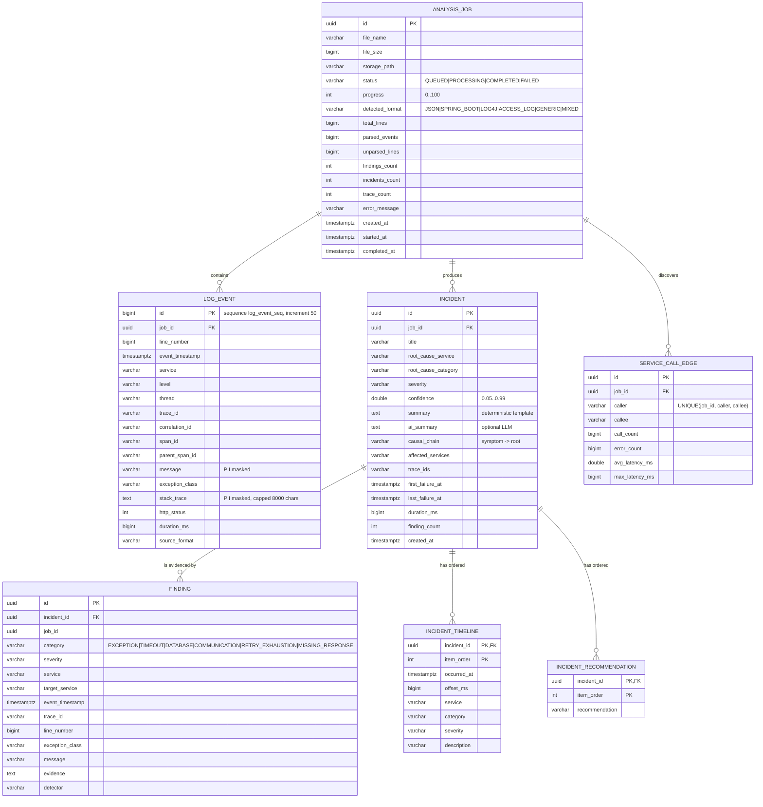

# LogSense – Entity Relationship Diagram

The schema is owned by Flyway (`src/main/resources/db/migration/V1__init.sql`). Hibernate runs with
`ddl-auto=none` in production; tests use H2 (`MODE=PostgreSQL`) with `create-drop`.

## Indexes

| Index | Purpose |
|---|---|
| `idx_log_event_trace (trace_id)` | transaction-flow reconstruction for one trace |
| `idx_log_event_job_ts (job_id, event_timestamp)` | time-ordered scans within a job |
| `idx_log_event_service_level (service, level)` | "all ERRORs of order-service" style queries |
| `idx_incident_first_failure`, `idx_incident_root_service`, `idx_incident_severity`, `idx_incident_job`, `idx_incident_created` | incident history filtering / sorting |
| `idx_finding_incident`, `idx_finding_job_category`, `idx_finding_service` | evidence lookup and the `service` filter (EXISTS sub-query) |
| `idx_job_status_created` | job listing / dashboard counts |

## Notes

* `log_event.id` uses a sequence with `INCREMENT BY 50` matching JPA `allocationSize=50` (pooled optimizer), so
  Hibernate can JDBC-batch inserts (`hibernate.jdbc.batch_size=1000`, `reWriteBatchedInserts=true`). `IDENTITY`
  would disable batching.
* All child tables use `ON DELETE CASCADE` so deleting a job removes its data in one statement (retention job).
* At larger scale `log_event` should be range-partitioned by `event_timestamp` (or moved to ClickHouse/Elasticsearch);
  see ARCHITECTURE.md.